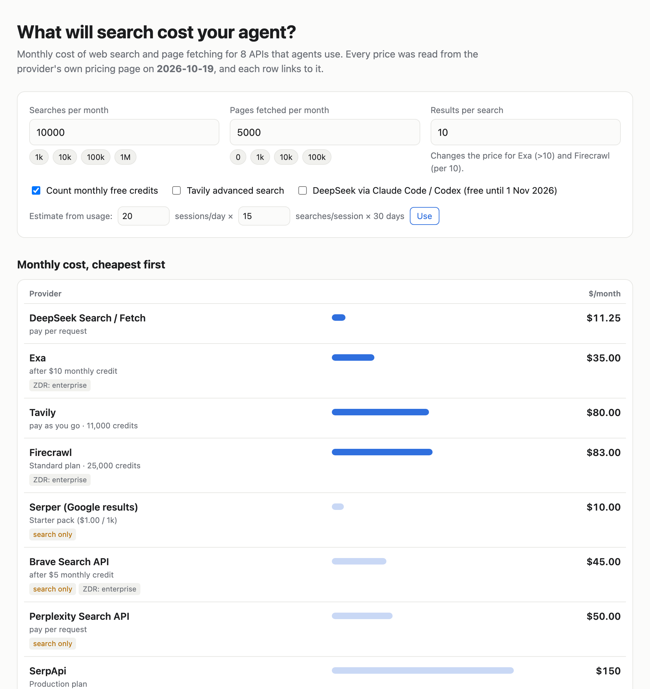

# agent-search-costs

**What will web search and page fetching cost your AI agent each month?**

   

**→ Open the calculator: https://thinx-pro.github.io/agent-search-costs/**

Enter searches and page fetches per month to see the cost for DeepSeek Search / Fetch, Brave, Exa, Tavily, Serper, SerpApi, Perplexity and Firecrawl, cheapest first. Each price links to the provider's own page.

## Why

DeepSeek launched [Search and Fetch endpoints](https://api-docs.deepseek.com/guides/search/) at $0.75 per 1,000 requests, free when called through Claude Code or Codex until 1 November 2026. The Hacker News discussion about it (500+ points) quickly turned into a price comparison in the comments: Brave $5, Exa $4, Serper about $1 per 1,000. The catch is that every provider bills differently: per request, per credit, per 10 results, prepaid packs that expire, or monthly plans with free credits. Comparing them for *your* volume means opening eight pricing pages and doing arithmetic. This page does the arithmetic.

## Quick start

1. Open https://thinx-pro.github.io/agent-search-costs/
2. Enter your searches and page fetches per month, or use the "sessions/day × searches/session" helper.
3. Read the cost table, then check the details cards for limits and data policy.

To run it locally: `git clone` the repo, then `python3 -m http.server --directory docs` and open http://localhost:8000.

## What it models

| provider | how it bills (as read on 2026-10-19) | fetch |
|---|---|---|
| [DeepSeek Search / Fetch](https://api-docs.deepseek.com/guides/search/) | $0.75 / 1k successful requests each; empty results and failures are free; free via Claude Code / Codex until 1 Nov 2026 (Beijing time) | ✔ |
| [Brave Search API](https://brave.com/search/api/) | $5 / 1k, with $5 of free credit a month | — |
| [Exa](https://exa.ai/pricing) | Search (instant) $4 / 1k with up to 10 results, +$1 / 1k per extra result; Contents $1 / 1k pages; $10 free a month | ✔ |
| [Tavily](https://docs.tavily.com/documentation/api-credits) | Credits: search 1 (advanced 2), extract 1 per 5 URLs; $0.008 / credit or monthly plans; 1,000 free credits a month | ✔ |
| [Serper](https://serper.dev/) | Prepaid packs valid 6 months: $1.00 → $0.30 / 1k | — |
| [SerpApi](https://serpapi.com/pricing) | Monthly plans: $25 for 1k … $275 for 30k searches; 250 free | — |
| [Perplexity Search API](https://docs.perplexity.ai/getting-started/pricing) | $5 / 1k requests ($1 / 1k with Fast Search) | — |
| [Firecrawl](https://www.firecrawl.dev/pricing) | Credits: search 2 per 10 results, scrape 1 per page; plans billed yearly; 1,000 free credits a month | ✔ |

How the totals are worked out:

- **Plans and credits:** the cheapest option that covers the volume (free tier, pay-as-you-go, or a plan). Overage pricing on plans was not listed, so a plan only counts if it covers the whole volume.
- **Serper packs** expire after 6 months. A pack you cannot use up in time is costed at its price ÷ 6 per month.
- **Search-only APIs** are ranked after the ones that can also fetch pages when you enter page fetches.
- Volumes above the largest public plan show "—".

All of this is in [`docs/calc.js`](docs/calc.js), and the prices are in [`docs/prices.js`](docs/prices.js). There are 10 tests (`npm test`) with hand-worked examples for each pricing model.

## Limitations

- Prices change. Each one was read on **2026-10-19** from the page linked in the table. If a number is out of date, please open an issue or PR with the link.
- It compares list prices, not quality. Result relevance, freshness, latency and content extraction quality differ a lot between these APIs and are not measured here.
- Data policy is shown only where the provider's pricing page states it. "Not on the page we read" means we did not find it there, not that there is no policy.
- Not included yet: Jina (token-based; the per-token price was not on the page we read), Kagi, Google Programmable Search / Vertex grounding.
- Taxes, enterprise discounts and one-time sign-up credits (for example Serper's 2,500 free queries) are ignored.

Roadmap: a quality spot-check (same 50 queries through each API, results published), more providers, and a JSON export for routing tools.

## License

MIT. Not affiliated with any of the providers listed.
